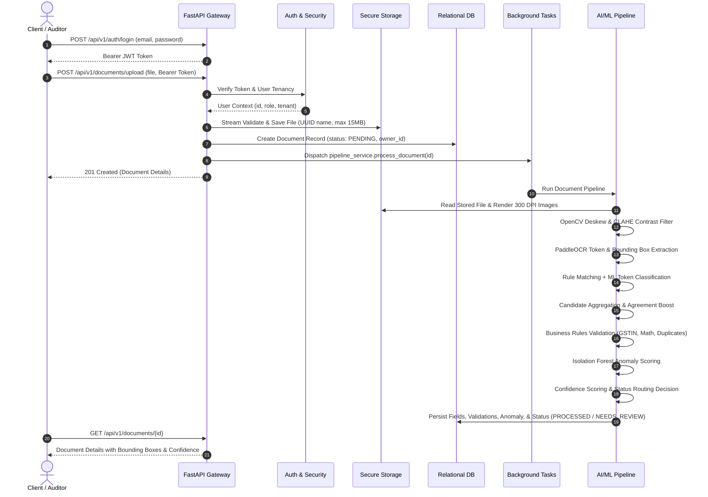
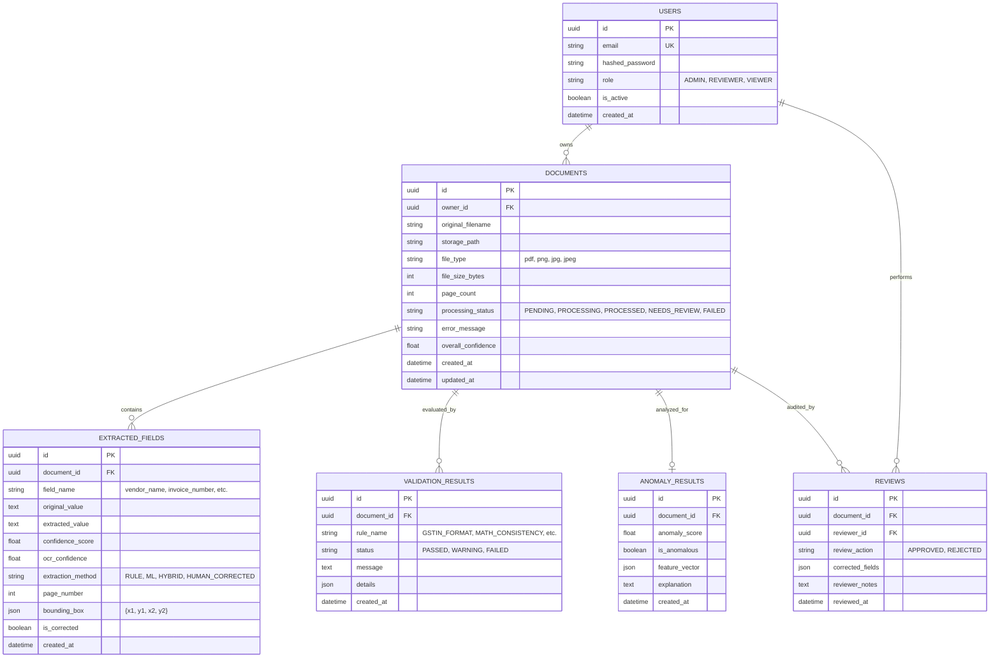

# Invoice IQ — System Architecture & Engineering Deep-Dive
**Identity:** Invoice IQ  
**Tagline:** Extract. Validate. Understand.  
**Version:** 2.0  
**Status:** Active Architectural Blueprint

---

## 1. System Vision & Problem Statement

**Invoice IQ** is an enterprise-grade intelligent document processing (IDP) and financial audit platform. Modern accounts payable teams receive thousands of invoices each month across hundreds of different vendor formats, image quality levels, and tax jurisdictions. Manual keying is costly, slow, and prone to accounting errors, while basic template OCR breaks on minor layout changes, and public cloud LLM APIs expose proprietary financial data and incur high recurring inference costs.

Invoice IQ provides an on-premise, self-contained AI/ML pipeline that combines:
1. **Computer Vision & OCR**: High-resolution 300 DPI page conversion, deskewing, CLAHE contrast enhancement, and character-level geometry normalization.
2. **Hybrid Field Extraction**: Blends deterministic regular expressions and keyword anchor proximity with an n-gram TF-IDF + Logistic Regression token classifier, resolved via candidate aggregation and agreement boosting.
3. **Deterministic Business Validation**: Indian GSTIN structure and state code validation, mathematical reconciliation ($|\text{Subtotal} + \text{Tax} - \text{Total}| \le 0.05$), date bounds, and compound duplicate detection.
4. **Unsupervised Anomaly Detection**: Isolation Forest scoring of financial transaction distributions coupled with historical vendor transaction Z-scores.
5. **Human-in-the-Loop (HITL) Verification**: Interactive split-screen review canvas featuring dynamic hover bounding boxes and non-destructive audit logging.
6. **Multi-Tenancy & Security**: JWT authentication, role-based access control, tenant document isolation, and streaming file upload limits.

---

## 2. High-Level Architecture Diagram

```
[ Ingest Layer ]
  User Browser / Client
       │
       ▼
  HTTPS / Reverse Proxy (Nginx)
       │
       ├─────────────────────────────────────────┐
       │ (Static Assets / SPA)                   │ (API Proxy /api/v1)
       ▼                                         ▼
  React 18 Frontend SPA                   FastAPI Application
  (Vite, Tailwind, Recharts)             (Async Python 3.11)
                                                 │
                                                 ├──► [ Security & Auth Middleware ]
                                                 │    (JWT Validation, RBAC, Rate Limiting)
                                                 │
                                                 ├──► [ Relational Data Store ]
                                                 │    (PostgreSQL / SQLite via SQLAlchemy 2.0)
                                                 │
                                                 ▼
                                        [ Background Pipeline Queue ]
                                                 │
  ┌──────────────────────────────────────────────┴──────────────────────────────────────────────┐
  ▼                                              ▼                                              ▼
Stage 1: Preprocessing                 Stage 2: OCR Extraction                        Stage 3: Hybrid Extraction
- PyMuPDF 300 DPI Rendering            - PaddleOCR (DB + SVTR)                        - Rule Anchor Engine
- OpenCV Deskew (±45°)                 - Fallback PyMuPDF Word Extractor              - ML Token Classifier
- CLAHE Contrast Balance               - Normalized BBoxes [0.0, 1.0]                 - Candidate Aggregation
  │                                              │                                              │
  └──────────────────────────────────────────────┼──────────────────────────────────────────────┘
                                                 ▼
  ┌──────────────────────────────────────────────┴──────────────────────────────────────────────┐
  ▼                                              ▼                                              ▼
Stage 4: Validation Engine             Stage 5: Anomaly Detection                     Stage 6: Confidence Scoring
- GSTIN Checksum & State (01-38)       - Isolation Forest (4 Features)                - Weighted Field Scoring
- Math Reconciliation (diff ≤ 0.05)    - Vendor Historical Z-Scores                   - Document-Level Decision Gate
- Duplicate Compound Checks            - Explainable Output Reasons                   - Routing (PROCESSED vs REVIEW)
  │                                              │                                              │
  └──────────────────────────────────────────────┼──────────────────────────────────────────────┘
                                                 ▼
                                   [ Persistent Storage & Review ]
                                   - Document & Extracted Fields Persisted
                                   - Status: PROCESSED or NEEDS_REVIEW
                                   - Corrected Audit Trail Logged to Reviews Table
```

---

## 3. Data Flow & Processing Stages



---

## 4. Database Schema Design

The relational schema is managed via SQLAlchemy 2.0 and version-controlled using Alembic migrations:



---

## 5. Machine Learning & Anomaly Detection Specifications

### Field Classification
- **Feature Pipeline**: Lexical indicators (`is_upper`, `is_digit`, `is_currency`), discrete spatial quantization ($\text{Y\_BAND}_0 \dots \text{Y\_BAND}_9$, $\text{X\_COL}_0 \dots \text{X\_COL}_4$), and neighborhood contexts ($\text{PREV\_}, \text{NEXT\_}$).
- **Vectorization**: Sublinear TF-IDF vectorizer ($1 \dots 2$ word/character n-grams).
- **Classification**: Multi-class Logistic Regression with balanced class weighting.
- **Candidate Aggregation**:
  $$\text{FinalScore} = \begin{cases}
  \min\left(1.0, \max(s_{\text{rule}}, s_{\text{ml}}) + 0.05\right) & \text{if values agree (HYBRID)} \\
  s_{\text{rule}} & \text{if Rule only or } s_{\text{rule}} \ge s_{\text{ml}} \\
  s_{\text{ml}} & \text{if ML only or } s_{\text{ml}} > s_{\text{rule}}
  \end{cases}$$

### Anomaly Detection
- **Model**: Scikit-learn `IsolationForest(n_estimators=100, contamination=0.05, random_state=42)`.
- **Feature Vector**:
  $$\vec{x} = \begin{bmatrix} \ln(\text{total} + 1) \\ \text{tax} / \max(1, \text{subtotal}) \\ \text{subtotal} / \max(1, \text{total}) \\ |\text{subtotal} + \text{tax} - \text{total}| \end{bmatrix}$$
- **Vendor Moving Z-Score**:
  $$z = \frac{\text{total} - \mu_{\text{vendor}}}{\sigma_{\text{vendor}}} \quad (\text{flagged if } |z| \ge 3.5 \text{ and } N \ge 3)$$

### Composite Confidence Scoring
- Field score:
  $$C_{\text{field}} = 0.50 \cdot c_{\text{ext}} + 0.30 \cdot c_{\text{ocr}} + 0.20 \cdot \mathbb{I}_{\text{valid}}$$
- Document score:
  $$C_{\text{doc}} = \sum_{k} w_k \cdot C_{\text{field}, k}$$
- **Routing Decision Gate**:
  If any mandatory field is missing $\implies$ `NEEDS_REVIEW`.  
  If any validation rule `status == "FAILED"` $\implies$ `NEEDS_REVIEW`.  
  If `is_anomalous == True` $\implies$ `NEEDS_REVIEW`.  
  If $C_{\text{doc}} < \tau$ (default 0.80) $\implies$ `NEEDS_REVIEW`.  
  Otherwise $\implies$ `PROCESSED`.
